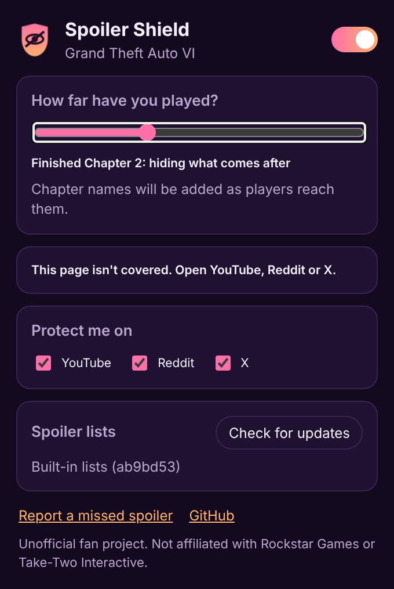

<p align="center">
  
</p>

<h1 align="center">Spoiler Shield</h1>

<p align="center">
  Hides GTA 6 story spoilers on YouTube, Reddit and X until you've played that far.
  <br />
  <a href="https://github.com/usamamuneerchaudhary/spoiler-shield/actions/workflows/ci.yml"></a>
  
  
</p>

> **Unofficial fan project.** Not affiliated with, endorsed by or connected to Rockstar Games or Take-Two Interactive.

<p align="center">
  
</p>

## What it does

- **Blurs spoilers as you scroll** on YouTube (videos, Shorts, comments, the watch page), Reddit (new and old) and X (posts and trends). Infinite scroll and recycled elements are handled.
- **Knows how far you've played.** Move the slider to the last chapter you finished, and only spoilers from later chapters stay hidden.
- **One click to reveal.** The Reveal button shows that item and never triggers the link or post underneath.
- **Pauses spoiler videos.** If the YouTube video you open is itself a spoiler, the player is covered and paused.
- **Never repeats the spoiler.** The overlay says which chapter something spoils, never the words it matched.
- **Lists update without a new release.** Spoiler lists are JSON in this repo; the extension downloads them from GitHub (data only, checked before use).
- **Private.** No accounts, no analytics, no tracking. See [PRIVACY.md](PRIVACY.md).



### How matching works

Every item's text (title, description, alt text, labels) is normalised (`"GTA-6's ÉNDING!"` → `gta 6 s ending`) and checked against phrases in the lists. Matching is whole-word, so "ending" never matches "spending".

To avoid false alarms, most rules only count when the text is also about the game (`gta 6`, `gta vi`, `#GTA6`, `vice city` …). Safe phrases like "no spoilers" and "spoiler-free" are ignored.

The engine is a separate, dependency-free package, [`spoiler-shield-matcher`](packages/matcher), so you can reuse it for other games, shows or a Discord bot.

<br clear="right" />

## Install the extension

Store listings are coming. Until then, install it from this repo in developer mode. It takes about a minute, and you don't need Node or a build step.

### 1. Get the code

```bash
git clone https://github.com/usamamuneerchaudhary/spoiler-shield.git
```

Or click **Code → Download ZIP** on GitHub and unzip it. Either way you get a `spoiler-shield` folder with an `extension` folder inside. That inner folder is the extension.

### 2a. Chrome, Edge, Brave, Arc, Opera

1. Open the extensions page: `chrome://extensions` (Edge: `edge://extensions`, Brave: `brave://extensions`).
2. Turn on **Developer mode**: the switch is at the top right (in Edge, it's in the left sidebar).
3. Click **Load unpacked**.
4. Select the **`spoiler-shield/extension`** folder, the one that contains `manifest.json`. Picking the repo root gives "Manifest file is missing".
5. Pin it so it's one click away: click the puzzle-piece icon in the toolbar, then the pin next to **Spoiler Shield**.
6. **Refresh** any YouTube, Reddit or X tabs that were already open. The extension only starts on pages loaded after it was installed.

Chrome shows a note about an unrecognised `browser_specific_settings` key. That key is for Firefox and the note is harmless.

### 2b. Firefox (version 142 or newer)

1. Open `about:debugging#/runtime/this-firefox`.
2. Click **Load Temporary Add-on…**
3. Select **`spoiler-shield/extension/manifest.json`**.
4. Allow it on the sites: click the puzzle-piece icon in the toolbar, then the gear next to **Spoiler Shield**, and allow it on YouTube, Reddit and X if Firefox asks. You can also do this from `about:addons` → **Spoiler Shield** → **Permissions**.
5. Pin it: same gear menu → **Pin to Toolbar**.
6. Refresh any YouTube, Reddit or X tabs that were already open.

A temporary add-on is removed when Firefox closes, so repeat these steps after a restart. Permanent installs come with the Firefox Add-ons listing.

### 3. Set how far you've played

Click the Spoiler Shield icon and move the slider to the last chapter you finished. "Not started" hides every story spoiler; "Finished the story" shows everything. Untick a site to turn the shield off there.

### Updating

Pull the latest code (`git pull`), then click the **reload** icon on the Spoiler Shield card in `chrome://extensions` (in Firefox: **Reload** in `about:debugging`) and refresh your open tabs.

Spoiler lists update on their own from this repo, at most every 6 hours, when you open the popup. **Check for updates** in the popup fetches them straight away.

### Troubleshooting

| Problem | Fix |
|---|---|
| Nothing is blurred | Refresh the tab. Check that the shield is on, the site is ticked, and the slider isn't at "Finished the story". In Firefox, check the site permissions (step 4). |
| "Manifest file is missing or unreadable" | You picked the repo folder. Pick the `extension` folder inside it. |
| "Couldn't update" in the popup | The lists are fetched from this repo's `main` branch on GitHub, so the repo must be public. The built-in lists keep working in the meantime. |
| Something isn't blurred that should be, or the reverse | [Open an issue](https://github.com/usamamuneerchaudhary/spoiler-shield/issues/new/choose). The templates keep spoilers out of issue titles. |

## Try the demo (no spoilers)

Open `demo/index.html` in your browser: double-click it, or run `open demo/index.html` on macOS. It uses a made-up game, Neon Harbor, so you can see blurring, the slider and Reveal without reading anything real. It doesn't need the extension installed.

## Development

You need Node 20 or newer.

```bash
npm install
npm test                          # matcher and list tests
npx playwright install chromium   # once, for the browser tests
npm run test:e2e                  # loads the real extension in Chromium
```

## Project layout

```
extension/            the browser extension (Manifest V3, Chrome + Firefox)
  content/            shield-core.js (blurring), sites.js (per-site selectors), main.js
  popup/              progress slider, site toggles, list updates
  data/, vendor/      generated by `npm run build`, committed so Load unpacked works
packages/matcher/     spoiler-shield-matcher: the matching engine, with types and tests
data/                 the source spoiler lists (⚠ data/spoilers/ contains spoilers)
demo/                 spoiler-free demo page
e2e/                  Playwright tests that load the real extension
scripts/              build, package and icon scripts
```

## Scripts

| Command | What it does |
|---|---|
| `npm run build` | Validates `data/` and regenerates `extension/data/` and `extension/vendor/` |
| `npm run check` | Fails if generated files are out of date (CI runs this) |
| `npm test` | Matcher unit tests plus checks of the real lists against `data/fixtures/titles.json` |
| `npm run test:e2e` | Loads the extension in Chromium against fake YouTube, Reddit and X pages (run `npx playwright install chromium` once) |
| `npm run package` | Zips the extension into `dist/` for the stores |

## Contributing spoilers

The lists are only as good as the people who add to them. Read [CONTRIBUTING.md](CONTRIBUTING.md) first: it explains how to add spoilers **without spoiling everyone reading the pull request**.

Found a spoiler that slipped through, or something blurred that shouldn't be? [Open an issue](https://github.com/usamamuneerchaudhary/spoiler-shield/issues/new/choose).

## Limitations

- Only text is checked. A thumbnail that shows a spoiler with a harmless title isn't caught.
- Sites change their markup. When something slips through, the fix is often a selector in [`extension/content/sites.js`](extension/content/sites.js).
- Chapter names are placeholders until players reach them.

## Roadmap

- [ ] Real chapter list and chapter spoiler packs
- [ ] Hashed spoiler lists, so the repo itself spoils nothing
- [ ] "Report a spoiler" button on blurred items, backed by a small Laravel API and a Filament moderation panel
- [ ] More sites (Twitch titles, TikTok, Google results)
- [ ] Packs for other games and shows

## Licence

Code: [MIT](LICENSE). Spoiler lists in `data/`: [CC0](data/LICENSE), free to reuse for anything.

Grand Theft Auto, GTA and related names are trademarks of Take-Two Interactive Software, Inc. They are used here only to describe what the extension filters.
