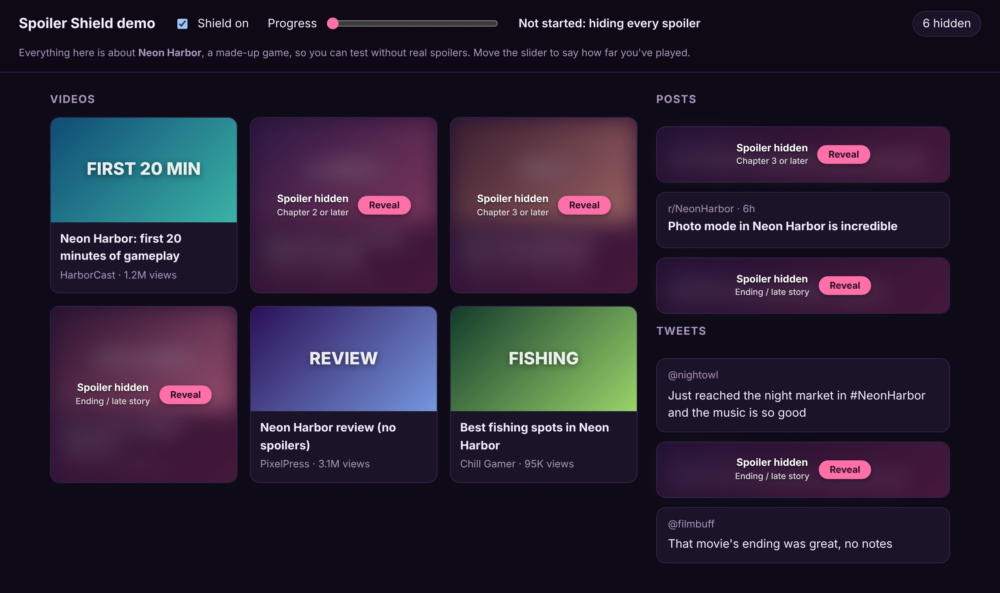

<p align="center">
  
</p>

<h1 align="center">Spoiler Shield</h1>

<p align="center">
  Hides story spoilers for GTA 6 and other games and shows on YouTube, Reddit and X, plus Twitch, TikTok and Google if you want, until you've caught up.
  <br />
  <a href="https://github.com/usamamuneerchaudhary/spoiler-shield/actions/workflows/ci.yml"></a>
  
  
  
  
</p>

> **Unofficial fan project.** Not affiliated with, endorsed by or connected to Rockstar Games, Take-Two Interactive, or the makers of any other game or show listed.

<p align="center">
  
</p>

## What it does

- **Blurs spoilers as you scroll** on YouTube (videos, Shorts, comments, the watch page), Reddit (new and old) and X (posts and trends). Infinite scroll and recycled elements are handled.
- **Covers more sites when you turn them on.** Twitch (stream cards, titles, chat), TikTok (videos, comments) and Google Search (results, "People also ask", videos, forums). Each asks for its own permission, so the extension never asks for more than you use.
- **Several games and shows.** Packs for *Grand Theft Auto VI*, *Marvel's Wolverine*, *007 First Light* and *Stranger Things*, each with its own "how far have I got" slider. Spoilers from what you've finished show again; everything after stays hidden.
- **One click to reveal.** Reveal shows that item and never triggers the link or post underneath. **Not a spoiler?** reveals it and reports the false alarm.
- **Report what slips through.** Right-click any text and pick **Report as spoiler**. Reports go to a moderation panel (the Laravel app in [`api/`](api)), or become pre-filled GitHub issues if no server is set up.
- **Pauses spoiler videos.** If the YouTube video you open is itself a spoiler, the player is covered and paused.
- **Never repeats the spoiler.** The overlay names the chapter number, never the words it matched or the name of a chapter you haven't reached.
- **The repo spoils nothing.** Chapter spoilers are stored as hashes and chapter names are encoded, so browsing the lists on GitHub doesn't ruin the story.
- **Lists update without a new release.** The extension downloads them from GitHub (data only, checked before use).
- **Private.** No accounts, no analytics, no tracking. See [PRIVACY.md](PRIVACY.md).


### How matching works

Every item's text (title, description, alt text, labels) is normalised (`"GTA-6's ÉNDING!"` → `gta 6 s ending`) and checked against phrases in the lists. Matching is whole-word, so "ending" never matches "spending".

To avoid false alarms, most rules only count when the text is also about that game or show (`gta 6`, `#GTA6`, `vice city`, `stranger things` …). Safe phrases like "no spoilers" and "spoiler-free" are ignored.

Chapter spoilers are stored as hashes: the extension hashes each run of words on the page and compares. That keeps the lists unreadable at a glance. It isn't encryption, though: someone could guess a phrase and check it.

The engine is a separate, dependency-free package, [`spoiler-shield-matcher`](packages/matcher), so you can reuse it for other games, shows or a Discord bot.

<br clear="right" />

## How the pieces fit

```
 browser extension ──── reads ────▶ extension/data/catalog.json  ◀── npm run build ── data/packs/*  (hashed lists)
        │                                     ▲                                             ▲
        │ "Report as spoiler"                 │ list updates via GitHub                     │ pull request
        ▼                                     │                                             │
 api/  (Laravel 13 + Filament 5) ── moderators accept reports as rules ── spoilers:export ──┘
```

## Install the extension

Store listings are coming. Until then, install it from this repo in developer mode. It takes about a minute, and you don't need Node or a build step.

### 1. Get the code

```bash
git clone https://github.com/usamamuneerchaudhary/spoiler-shield.git
```

Or click **Code → Download ZIP** on GitHub and unzip it. Either way you get a `spoiler-shield` folder with an `extension` folder inside. That inner folder is the extension.

### 2a. Chrome, Edge, Brave, Arc, Opera

1. Open the extensions page: `chrome://extensions` (Edge: `edge://extensions`, Brave: `brave://extensions`).
2. Turn on **Developer mode**: the switch is at the top right (in Edge, it's in the left sidebar).
3. Click **Load unpacked**.
4. Select the **`spoiler-shield/extension`** folder, the one that contains `manifest.json`. Picking the repo root gives "Manifest file is missing".
5. Pin it so it's one click away: click the puzzle-piece icon in the toolbar, then the pin next to **Spoiler Shield**.
6. **Refresh** any YouTube, Reddit or X tabs that were already open. The extension only starts on pages loaded after it was installed.

Chrome shows a note about an unrecognised `browser_specific_settings` key. That key is for Firefox and the note is harmless.

### 2b. Firefox (version 142 or newer)

1. Open `about:debugging#/runtime/this-firefox`.
2. Click **Load Temporary Add-on…**
3. Select **`spoiler-shield/extension/manifest.json`**.
4. Allow it on the sites: click the puzzle-piece icon in the toolbar, then the gear next to **Spoiler Shield**, and allow it on YouTube, Reddit and X if Firefox asks. You can also do this from `about:addons` → **Spoiler Shield** → **Permissions**.
5. Pin it: same gear menu → **Pin to Toolbar**.
6. Refresh any YouTube, Reddit or X tabs that were already open.

A temporary add-on is removed when Firefox closes, so repeat these steps after a restart. Permanent installs come with the Firefox Add-ons listing.

### 3. Pick your games and shows, and how far you've got

Click the Spoiler Shield icon.

- **Pick what you're playing or watching.** Tick it (GTA 6 is on by default) and move its slider to the last chapter, part or season you finished. "Not started" hides every story spoiler; "Finished" shows everything.
- **Choose the sites.** Untick a site to turn the shield off there.
- **Add Twitch, TikTok or Google** by ticking them. The browser asks for permission once; refresh open tabs on that site afterwards.

### 4. Report what slips through

- **A spoiler wasn't hidden:** select its text (or right-click its link) and choose **Report as spoiler**.
- **Something was hidden by mistake:** click **Not a spoiler?** on the blur.

Either way a form opens with everything filled in, and nothing is sent until you press **Send report**.

### Updating

Pull the latest code (`git pull`), then click the **reload** icon on the Spoiler Shield card in `chrome://extensions` (in Firefox: **Reload** in `about:debugging`) and refresh your open tabs.

Spoiler lists update on their own from this repo, at most every 6 hours, when you open the popup. **Check for updates** in the popup fetches them straight away.

### Troubleshooting

| Problem | Fix |
|---|---|
| Nothing is blurred | Refresh the tab. Check that the shield is on, the site is ticked, the game or show is ticked, and its slider isn't at "Finished". In Firefox, check the site permissions (step 4). |
| Twitch, TikTok or Google stays unticked | The browser's permission prompt was dismissed. Tick it again and choose **Allow**. |
| "Manifest file is missing or unreadable" | You picked the repo folder. Pick the `extension` folder inside it. |
| "Couldn't update" in the popup | The lists are fetched from this repo's `main` branch on GitHub, so the repo must be public. The built-in lists keep working in the meantime. |
| Something isn't blurred that should be, or the reverse | [Open an issue](https://github.com/usamamuneerchaudhary/spoiler-shield/issues/new/choose). The templates keep spoilers out of issue titles. |

## Try the demo (no spoilers)

Open `demo/index.html` in your browser: double-click it, or run `open demo/index.html` on macOS. It uses a made-up game, Neon Harbor, so you can see blurring, the slider and Reveal without reading anything real. It doesn't need the extension installed.

## Development

You need Node 20 or newer, and PHP 8.3+ with Composer for the API.

```bash
npm install
npm test                          # matcher, lists and contributor-tool tests
npx playwright install chromium   # once, for the browser tests
npm run test:e2e                  # loads the real extension in Chromium

cd api && composer run setup && php artisan test   # the Laravel API and Filament panel
```

The API's own README covers running the moderation panel, the report API and deployment: [api/README.md](api/README.md).

## Project layout

```
extension/            the browser extension (Manifest V3, Chrome + Firefox)
  content/            shield-core.js (blurring), sites.js (per-site selectors), main.js
  popup/              a slider per game or show, site toggles, list updates
  report/             the report form
  background.js       optional sites, right-click menu, opening reports
  data/, vendor/      generated by `npm run build`, committed so Load unpacked works
packages/matcher/     spoiler-shield-matcher: the matching engine, with types and tests
data/                 the source lists: data/packs/<pack>/ (hashed) and data/shared/generic.json
api/                  Laravel 13 + Filament 5: report API and moderation panel
demo/                 spoiler-free demo page
e2e/                  Playwright tests that load the real extension
scripts/              build, list tool (npm run spoiler), package and icon scripts
```

## Scripts

| Command | What it does |
|---|---|
| `npm run build` | Validates `data/` and regenerates `extension/data/` and `extension/vendor/` |
| `npm run check` | Fails if generated files are out of date (CI runs this) |
| `npm test` | Matcher unit tests, checks of the real lists against `data/fixtures/titles.json`, and the list tool's tests |
| `npm run test:e2e` | Loads the extension in Chromium against fake YouTube, Reddit, X, Twitch, TikTok and Google pages (run `npx playwright install chromium` once) |
| `npm run spoiler -- <command>` | Add hashed spoilers, check text, set chapter names, create packs. See [CONTRIBUTING.md](CONTRIBUTING.md). |
| `npm run package` | Zips the extension into `dist/` for the stores |

## Contributing spoilers

The lists are only as good as the people who add to them. Read [CONTRIBUTING.md](CONTRIBUTING.md) first: it explains how to add spoilers **without spoiling everyone reading the pull request**, using the `npm run spoiler` tool that hashes phrases for you. New games and shows are welcome too.

Found a spoiler that slipped through, or something blurred that shouldn't be? [Open an issue](https://github.com/usamamuneerchaudhary/spoiler-shield/issues/new/choose).

## Limitations

- Only text is checked. A thumbnail that shows a spoiler with a harmless title isn't caught.
- Sites change their markup. When something slips through, the fix is often a selector in [`extension/content/sites.js`](extension/content/sites.js). Google and TikTok rename their classes often.
- Chapter names and chapter spoilers fill in as players reach them. Until then, each pack hides endings, deaths, twists and full-story videos until you say you've finished.
- Hashing hides the lists from casual reading, not from someone determined to guess phrases.

## Roadmap

- [x] Packs for several games and shows, each with its own progress
- [x] Hashed spoiler lists and encoded chapter names, so the repo itself spoils nothing
- [x] Reporting from the page, with a Laravel API and a Filament moderation panel
- [x] Twitch, TikTok and Google Search as opt-in sites
- [ ] Real GTA 6 chapter list and chapter spoilers (as players get there)
- [ ] Open pull requests straight from the moderation panel
- [ ] More packs: suggest one in an issue

## Licence

Code: [MIT](LICENSE). Spoiler lists in `data/`: [CC0](data/LICENSE), free to reuse for anything.

Grand Theft Auto, GTA and related names are trademarks of Take-Two Interactive Software, Inc. Other game and show names belong to their owners. They are used here only to describe what the extension filters.
