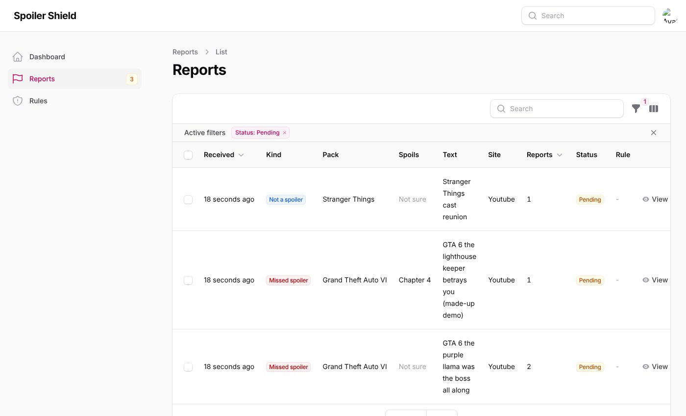
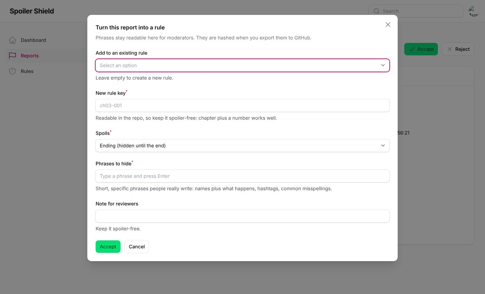

# Spoiler Shield API and moderation panel

A Laravel 13 app with a Filament 5 panel. The browser extension sends reports here ("a spoiler wasn't hidden", "this isn't a spoiler"). Moderators review them in the panel and turn them into rules. The rules are then exported as hashed list files for the repo, so the fix reaches every user through the normal list update.

<p align="center">
  
</p>

## How a report flows

1. A user right-clicks text and picks **Report as spoiler**, or clicks **Not a spoiler?** on a blurred item. They check the form and press Send.
2. `POST /api/v1/reports` validates the report against the packs in `extension/data/catalog.json`. Identical pending reports are folded into one, with a counter.
3. A moderator opens **Reports**:
   - **Accept** a missed spoiler: create a rule (or add to one) with the phrases to hide.
   - **Mark fixed** a false alarm once the lists are corrected.
   - **Reject** anything else.
4. `php artisan spoilers:export gta6 --path=../data/packs/gta6/spoilers` merges the rules into the repo as hashes. Or use **Rules → Download for GitHub** to get a zip.
5. Run `npm run build && npm test` at the repo root and open a pull request. Once merged, extensions pick up the new lists within hours.

<p align="center">
  
</p>

## Run it locally

You need PHP 8.3+, Composer and Node (for one cross-check test). [Laravel Herd](https://herd.laravel.com) has all of them.

```bash
cd api
composer run setup                 # installs, creates .env and the SQLite database, migrates
php artisan make:filament-user     # your moderator login
php artisan serve
```

Open http://127.0.0.1:8000/admin and sign in.

To point your local extension at it, set `reportApiUrl: 'http://127.0.0.1:8000'` in `extension/config.js`, then reload the extension.

## API

### `POST /api/v1/reports`

JSON body:

| Field | Type | Rules |
|---|---|---|
| `kind` | string | `missed_spoiler` or `false_alarm` |
| `pack` | string | A pack id from the catalog, e.g. `gta6` |
| `chapter` | integer or null | 1 to the pack's chapter count; null means "not sure" |
| `text` | string | Required, up to 500 characters |
| `page_url` | string or null | `http(s)` URL, up to 2048 characters; only sent if the user ticks it |
| `site` | string or null | `youtube`, `reddit`, `x`, `twitch`, `tiktok` or `google` |
| `note` | string or null | Up to 300 characters |
| `extension_version` | string or null | e.g. `0.2.0` |
| `list_version` | string or null | The catalog's `listVersion` |

Responses:
- **201** `{"id": 12, "status": "pending"}`: a new report.
- **200** `{"id": 12, "status": "pending", "merged": true}`: same as a pending report, so its counter went up.
- **422**: Laravel validation errors, `{"message": "...", "errors": {"field": ["..."]}}`.
- **429**: rate limit (10 a minute and 100 a day per connection, configurable).

CORS allows any origin, because the extension calls from its own `chrome-extension://` or `moz-extension://` origin. No cookies are used.

## Privacy

- The API stores what the user chose to send, plus an HMAC of their IP address (to spot abuse). It never stores the IP itself.
- Reviewed reports are deleted after 180 days by the scheduled `model:prune` command (`SPOILER_SHIELD_RETENTION_DAYS`). Pending reports are kept until reviewed.

Run the scheduler in production (`php artisan schedule:work`, or a cron entry for `schedule:run`).

## Settings

All optional, in `.env`:

| Variable | Default | What it does |
|---|---|---|
| `SPOILER_SHIELD_CATALOG_PATH` | `../extension/data/catalog.json` | Where to read the packs when the API runs inside the repo |
| `SPOILER_SHIELD_CATALOG_URL` | the catalog on GitHub | Used when the file above isn't there (cached for an hour) |
| `SPOILER_SHIELD_RETENTION_DAYS` | `180` | Days to keep reviewed reports |
| `SPOILER_SHIELD_REPORTS_PER_MINUTE` / `_PER_DAY` | `10` / `100` | Rate limits per connection |
| `SPOILER_SHIELD_MODERATORS` | empty | Comma-separated emails allowed into the panel; empty means every user |

## Deploying

Any PHP host works: Laravel Cloud, Forge, a VPS, Railway, Fly.io. The app uses SQLite by default and switches to MySQL or Postgres through the usual `DB_*` variables.

1. Deploy the `api/` folder, run `composer install --no-dev` and `php artisan migrate --force`.
2. Create a moderator with `php artisan make:filament-user`.
3. Schedule `php artisan schedule:run` every minute.
4. Set `reportApiUrl` in `extension/config.js` to your URL, then rebuild and publish the extension. Also update the privacy disclosures in the Chrome Web Store listing: the extension now sends reports to your server.

## Tests

```bash
cd api
php artisan test
```

The suite covers the API (validation, merging, rate limits, CORS, privacy), the moderation actions, the Filament pages, pruning, and the exporter. It also includes two cross-checks with the extension:
- **Hashing:** PHP's normalising and hashing are compared with vectors generated by the JavaScript matcher (`tests/Fixtures/hash-vectors.json`, written by `node scripts/hash-vectors.mjs` at the repo root).
- **Export:** exported files are fed to the real JavaScript matcher, which must accept them and hide the phrase.
